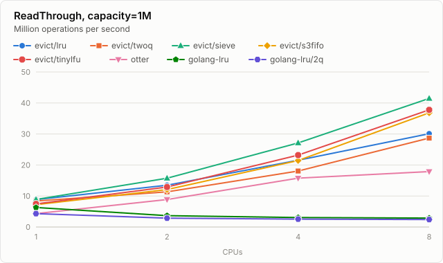

# evict

[](https://pkg.go.dev/github.com/floatdrop/evict)
[](https://github.com/floatdrop/evict/actions/workflows/ci.yml)

Fixed-capacity in-memory caches for Go: one API, five eviction policies.

| Package | Evicts | Reads |
|:---|:---|:---|
| [`lru`](https://pkg.go.dev/github.com/floatdrop/evict/lru) | the least recently used entry | take the lock of a shard |
| [`twoq`](https://pkg.go.dev/github.com/floatdrop/evict/twoq) | with [2Q](http://www.vldb.org/conf/1994/P439.PDF), which keeps new entries apart from proven ones | take the lock of a shard |
| [`sieve`](https://pkg.go.dev/github.com/floatdrop/evict/sieve) | with [SIEVE](https://www.usenix.org/conference/nsdi24/presentation/zhang-yazhuo), a queue with lazy promotion | take no lock |
| [`s3fifo`](https://pkg.go.dev/github.com/floatdrop/evict/s3fifo) | with [S3-FIFO](https://dl.acm.org/doi/10.1145/3600006.3613147), which makes new entries prove themselves in a small queue first | take no lock |
| [`tinylfu`](https://pkg.go.dev/github.com/floatdrop/evict/tinylfu) | with S3-FIFO's queues and the admission of [TinyLFU](https://arxiv.org/abs/1512.00727): once the cache is full, a new entry gets into its main queue only if its key has been asked for more often of late than the entry it would push out | take no lock |

All of them

- **allocate nothing** once they are created: entries live in arrays that are set up front and
  are addressed by 32-bit indices;
- **leave the garbage collector alone**: a cache of a million integers is a handful of
  pointer-free arrays, which the collector does not look into;
- **tell you what they dropped**: `Set` returns the entry it replaced or evicted, so that
  whatever the entry held on to can be released;
- **are safe for concurrent use**: entries are spread over shards that are locked one by one,
  and `sieve`, `s3fifo` and `tinylfu` read without a lock at all;
- depend on nothing but the standard library.

```
go get github.com/floatdrop/evict
```

Requires Go 1.26 or later.

## Usage

```go
package main

import (
	"fmt"

	"github.com/floatdrop/evict/tinylfu"
)

func main() {
	cache := tinylfu.New[string, int](10_000)

	cache.Set("answer", 42)

	if value, ok := cache.Get("answer"); ok {
		fmt.Println(value)
	}

	// Set hands back what it pushed out: the previous entry for the key, or
	// the entry that was evicted to make room.
	if key, value, displaced := cache.Set("answer", 43); displaced {
		fmt.Println("dropped", key, value)
	}

	for key, value := range cache.All() {
		fmt.Println(key, value)
	}
}
```

The five packages have the same methods, which are also the interface
[`evict.Cache`](https://pkg.go.dev/github.com/floatdrop/evict#Cache):

| Method | |
|:---|:---|
| `Get(key) (value, ok)` | Looks an entry up and tells the eviction policy that it was used. |
| `Peek(key) (value, ok)` | Looks an entry up without telling the policy. |
| `Set(key, value) (oldKey, oldValue, displaced)` | Stores an entry and returns the one that left the cache as a result. |
| `Delete(key) (value, ok)` | Removes an entry. |
| `Len()`, `Cap()` | The number of entries, and the number there is room for. |
| `Clear()` | Removes every entry. |
| `All()` | Iterates over the entries. |

`New` takes options. All five packages have `WithShards`. `twoq` has `WithRecentRatio` and
`WithGhostRatio` for the sizes of its queues, and `s3fifo` has `WithSmallRatio`,
`WithGhostRatio`, `WithPromotionReads` and `WithGhostReturns` for tuning it to a workload
that is known; see [what that is worth](bench/results/tuning.md). `tinylfu` has nothing else
to set: it finds the size of its small queue by itself.

## Choosing a policy

**If in doubt, use `tinylfu`.** On the eleven traces that the benchmarks replay it answers
more requests on average than any other cache here, otter included: 47.9% of them, against
47.5% for otter and 44.8% for `s3fifo`. At no capacity is it more than 5.3 points behind
the best cache, and its reads take no lock. Two things temper that. It was designed with
these very traces at hand; on fourteen others, in a simulation of the policy that is not
part of this repository, it came out level with S3-FIFO and W-TinyLFU. And it has weak
spots of its own: on the trace called Mixed, at its larger capacities, it answers up to four
points less than `lru`, and where every key comes back once or twice after much the same
while and never again, it can answer far less than `lru` does; see
[its documentation](https://pkg.go.dev/github.com/floatdrop/evict/tinylfu).

| | Use it when | Mind |
|:---|:---|:---|
| `tinylfu` | you do not know the workload, or it has loops or scans in it, and it is read far more than it is written | Writes that evict get 5 to 10% less done than in `s3fifo`, and with eight CPUs and 1% writes among the reads it was 22% slower than `s3fifo` here. Its hit ratio varies from one run to the next, by up to 5.6 points on these traces: keys share counters in its sketch by a hash that is seeded at random. |
| `s3fifo` | you want the same answers on every run, or the workload is read far more than it is written and has no loops in it | It falls far behind on Mixed, a trace with loops, and a few points behind on Glimpse. On Mixed, at some capacities, it answers what `lru` answers while `tinylfu`, `twoq` and otter answer four to six times as much. Writes cost about twice what they do in `lru`, and at worst three times. A cache of fewer than ten entries per shard is too small for it. |
| `sieve` | several CPUs read through the cache and it has to be as fast as can be, in less memory than `s3fifo` and `tinylfu` take, and you have measured that your workload is one it copes with | It can fail outright. On one of the traces a SIEVE cache in one piece answers less than 1% of the requests where LRU answers 44%; see [when not to use it](https://pkg.go.dev/github.com/floatdrop/evict/sieve#hdr-When_not_to_use_it). On the traces here its hit ratio is ahead of that of `s3fifo` on one only. |
| `twoq` | a quarter or more of the operations are writes, or one goroutine at a time uses the cache | It takes more memory than `lru` and `sieve`, because it keeps a node for every key it remembers. Reads take a lock. |
| `lru` | memory is what counts, there are a great many small caches, or you want the behavior that everyone knows | The lowest hit ratio of the five on nine traces of eleven. Reads take a lock. |

And when to use [otter](https://github.com/maypok86/otter) instead: when you need what
these caches do not have (expiry, weights, loading, statistics), or when eight CPUs read a
cache while a tenth to a quarter of their operations overwrite entries. (For writes alone,
`twoq` and `lru` stay ahead.) The numbers are below.

## Benchmarks

The benchmarks are in [`bench`](bench), a module of its own, and compare the five caches
with otter v2, the state of the art among Go caches, and with hashicorp's `golang-lru`, a
cache behind a single lock. [bench/README.md](bench/README.md) says what is measured and
how; `make bench` runs it all again. What follows is a summary of
[bench/results](bench/results).

### Hit ratio

The share of requests, in percent, that a cache answers when a trace is replayed against
it, averaged over the eight capacities at which each trace is replayed. Ten of the traces
are public recordings of real systems, checked against a SHA-256 before they are used;
`optimal` is the bound that no cache can beat. The hit ratios of otter and of `tinylfu`
differ from one replay to the next, by up to 4.1 and 5.6 points, so they are replayed eleven
times: their numbers are medians, and a number is in bold only if the cache leads whichever
of those replays it is compared with.

| trace | evict/lru | evict/twoq | evict/sieve | evict/s3fifo | evict/tinylfu | otter | golang-lru/2q | optimal |
|:---|---:|---:|---:|---:|---:|---:|---:|---:|
| Zipf | 29.97 | 36.53 | 37.55 | **38.25** | 37.66 | 37.90 | 37.61 | 44.07 |
| S3 | 23.33 | 32.78 | 35.54 | 38.90 | **44.83** | 44.57 | 33.15 | 59.37 |
| DS1 | 23.70 | 28.88 | 38.87 | 37.05 | **47.07** | 46.54 | 34.47 | 50.21 |
| OLTP | 32.40 | 39.07 | 30.60 | 39.11 | 38.76 | 38.97 | 37.60 | 52.77 |
| P8 | 24.10 | 32.11 | 27.66 | 35.31 | **37.86** | 36.20 | 31.45 | 53.53 |
| Glimpse | 21.81 | 27.40 | 30.14 | 43.24 | 45.20 | 45.28 | 33.20 | 47.81 |
| Mixed | 44.11 | 56.80 | 0.43 | 43.84 | 60.32 | **61.61** | 35.97 | 64.22 |
| Scarab | 59.10 | 61.00 | 60.53 | **61.60** | 60.31 | 58.99 | 61.14 | 70.30 |
| Twitter | 58.37 | 59.72 | 58.99 | **60.32** | 59.59 | 59.29 | 58.80 | 65.46 |
| MSR | 64.40 | 66.31 | 66.16 | **67.22** | 67.06 | 66.54 | 66.57 | 73.60 |
| CloudPhysics | 20.90 | 24.41 | 24.70 | 27.59 | 27.80 | 26.77 | 25.59 | 34.23 |

- **`s3fifo` and `tinylfu` share the wins.** Of the 88 combinations of trace and capacity,
  `s3fifo` wins 32 outright and `tinylfu` 25. Six go to one of the 2Q caches, one to otter,
  and 24 have no clear winner.
- **`s3fifo` is ahead** on Zipf and OLTP and on the traces of a recommendation service, a
  key-value cache and block storage (Scarab, Twitter, MSR), by 0.2 to 1.3 points over
  `tinylfu` on average and by no more than 2.5 at any capacity.
- **`tinylfu` and otter are ahead by more where they are ahead**: on two of the disk traces
  of the ARC paper and on the two traces with loops in them (S3, DS1, Glimpse, Mixed), by 2
  to 18 points over `s3fifo` on average, and by 58 and 61 at the capacity where `s3fifo`
  does worst. On P8 and CloudPhysics `tinylfu` is ahead of every other cache.
- **`tinylfu` and otter are close.** `tinylfu` is ahead on average on seven of the traces,
  by up to 1.7 points (P8), and otter on the other four, by up to 1.3 (Mixed). Of the 88
  combinations, `tinylfu` is ahead on every replay in 42 and behind in 14. These are the
  traces that `tinylfu` was designed with, which favors it.
- **`sieve` is close behind `s3fifo` where it works**: about a point on Zipf, Scarab,
  Twitter and MSR, about three on S3 and CloudPhysics, and ahead of it on DS1. Where it
  does not work it is far behind: 8 to 13 points on OLTP, P8 and Glimpse, and on Mixed it
  answers next to nothing.
- **`twoq` is ahead of `lru` on the average of every trace**, though not at every capacity:
  `lru` leads in 10 of the 88 combinations. Of the five here only `tinylfu` beats it on Mixed.
- **Neither otter nor `tinylfu` has a bad trace.** In none of the 88 combinations is otter
  more than 5.9 points behind the best cache, or `tinylfu` more than 5.3. Each of the other
  four here is somewhere: `twoq` by 32 points, `s3fifo` and `lru` by 63, `sieve` by 76.
- Averages hide a lot. [hitratio.md](bench/results/hitratio.md) has every capacity, with a
  chart for each trace.

These numbers are for caches in one piece, so that the policy is all that is compared. A
program gets shards by default, and [sharding.md](bench/results/sharding.md) has what that
changes to the median of eleven runs: about a tenth of a point at the most for `s3fifo`;
the same for `lru` but for one case of more than a point on Glimpse, a short trace; and the
same for `twoq` but for two cases of half a point and of a point. For `sieve` it changes a
great deal on two of the traces it does badly on, for the better: 3 to 4 points on OLTP and
anything from 2 to 41 on Mixed, depending on the capacity. On P8 it is a point or so at the
most, and on Glimpse nothing. `tinylfu` loses a little in shards: about a point on DS1 at a
million entries, half a point on S3 and P8 at their smaller capacities, and 2.6 points on
Mixed at 750 entries; some of what the report shows for it is not the shards but how much
it varies from one replay to the next anyway. It was measured for a machine with eight CPUs;
one with more gives a cache of some size more and smaller shards.

### Throughput

Millions of operations per second with one CPU and with eight (`1 → 8`), each CPU running
a goroutine against the same cache of 16,384 string entries unless it says otherwise. The
numbers are medians of five runs on an Apple M3 Max with Go 1.27.3;
[throughput.md](bench/results/throughput.md) has two and four CPUs as well, the range of
the runs, and which differences are beyond noise.

| Benchmark | evict/lru | evict/twoq | evict/sieve | evict/s3fifo | evict/tinylfu | otter | golang-lru |
|:---|---:|---:|---:|---:|---:|---:|---:|
| `Get`: reads, all of them hits | 39.7 → 35.9 | 46.7 → 44.4 | 35.6 → 265.8 | 36.1 → 274.7 | 35.0 → 258.1 | 27.2 → 202.3 | 34.2 → 4.3 |
| `Mixed`: the same, 10% of them writes | 37.6 → 34.0 | 42.5 → 42.8 | 32.9 → 68.6 | 33.4 → 69.9 | 33.1 → 62.6 | 21.7 → 80.8 | 33.5 → 4.4 |
| `Set`: writes that replace | 36.5 → 24.9 | 43.3 → 28.4 | 22.4 → 13.8 | 22.5 → 13.6 | 22.2 → 12.8 | 8.9 → 15.9 | 32.1 → 4.3 |
| `Evict`: writes that evict | 16.5 → 31.3 | 16.9 → 30.9 | 13.4 → 12.0 | 8.6 → 10.5 | 8.2 → 9.8 | 3.6 → 5.9 | 7.5 → 3.3 |
| `ReadThrough`: read, store on a miss | 30.3 → 34.1 | 31.9 → 33.7 | 28.6 → 53.3 | 22.1 → 43.1 | 21.7 → 46.0 | 12.7 → 23.6 | 16.7 → 3.6 |
| `ReadThrough`, a million entries | 8.8 → 30.1 | 8.4 → 28.7 | 8.9 → 41.5 | 7.2 → 36.8 | 7.5 → 37.8 | 4.3 → 17.9 | 6.3 → 2.9 |



- **Reads scale in `sieve`, `s3fifo` and `tinylfu`**, as they do in otter: with eight CPUs
  they read 28 to 36% faster than otter does. `lru` and `twoq` read under a lock,
  and with eight CPUs they are slower than with four.
- **With one CPU all five are faster than otter** at everything measured, by a factor of
  1.3 to 5.
- **Reading through is what the caches that read without a lock are best at.**
  `ReadThrough` is the benchmark that comes closest to a cache in front of a database. From
  two CPUs on `sieve` is the fastest in it, and from four on `s3fifo` or `tinylfu` is the
  second; with one CPU it is `twoq`, or `sieve` and `lru` with a million entries. With
  eight CPUs, those three do about twice what otter does.
- **`tinylfu` reads about as fast as `s3fifo`, and writes a little slower.** With one, two
  and eight CPUs its `Get` is within 6% of that of `s3fifo`; with four, both vary by about a
  third from run to run. With eight CPUs it reads through faster, because it misses less.
  Its writes do more, for its sketch: those that evict get 5 to 10% less done, and those
  that replace about as much but for 17% less with four CPUs. With 1% writes among the
  reads and eight CPUs it falls further behind, by 22%; with 10% the medians differ by 10%,
  but the runs overlap. In an experiment that is not part of this repository, taking out
  what `tinylfu` does differently on that path did not close the gap, and it has not been
  explained yet.
- **Writes are where `lru` and `twoq` are at home.** They change an entry in place. `sieve`,
  `s3fifo` and `tinylfu` move a replaced entry to a fresh node so that readers need no lock.
  A write that replaces costs them 1.6 to 2.6 times as much, and up to 3.4 times with four
  CPUs; one that evicts costs 1.2 to 3.2 times as much. Their replacing writes are fastest
  with one CPU, and every cache here writes slower with eight CPUs than with four.
- **Otter wins when eight CPUs keep overwriting the entries that they read**: by a sixth
  over `sieve` and `s3fifo` and by more than a quarter over `tinylfu` with 10% writes, and
  by nearly a quarter over `twoq` with 25%. With four CPUs the fastest of the caches here are
  still well ahead, though `lru` is behind otter up to 10% writes and ahead of it only with
  25%.
- **One machine is one machine.** In the numbers that otter publishes, from Linux on x86,
  its writes get five times as fast between one CPU and eight; here they do not get twice
  as fast. How the caches compare on such a machine may well differ, and the `Benchmarks`
  workflow of this repository measures on GitHub's Linux runners for a second opinion.
  A benchmark that does nothing but call a cache also overstates every difference that a
  program would see.

### Memory and the garbage collector

What a cache takes for every entry it has room for, with `uint64` keys and values, which
are 16 of the bytes themselves. The ranges are over caches of ten thousand to ten million
entries. [memory.md](bench/results/memory.md) has every size, and strings.

| | Bytes per entry | of which the collector has to scan | CPU time of one collection, a million entries | ten million |
|:---|---:|---:|---:|---:|
| evict/lru | 46–58 | 0–1 | 0.2 ms | 0.2 ms |
| evict/sieve | 54–72 | 0–2 | 0.4 ms | 0.2 ms |
| evict/twoq | 74–82 | 0–1 | 0.4 ms | 0.2 ms |
| evict/s3fifo | 68–90 | 0–2 | 0.3 ms | 0.2 ms |
| evict/tinylfu | 67–82 | 0–2 | 0.4 ms | 0.2 ms |
| otter | 83–94 | 40–50 | 64 ms | 634 ms |
| golang-lru | 110–127 | 93–111 | 65 ms | 740 ms |
| golang-lru/2q | 156–183 | 136–163 | 97 ms | 1,167 ms |

The bytes per entry go up and down with the capacity, because the index of a cache has a
power of two of slots, and the ranges overlap: at 100,000 entries `s3fifo` takes 90 bytes
and otter 83. What does not overlap is the work for the garbage collector. A cache that is
made of pointers gives it more to do the larger it is, and a cache of this module gives it
next to nothing at any size. That is for keys and values that hold no pointers. If they do,
as strings do, the collector has to go through the entries to follow them, which was not
measured here.

## How it works

**Entries live in arrays.** A shard allocates its nodes once, as one array, and links them into
queues by 32-bit index instead of by pointer. Keys are found through an open-addressing index
of 64-bit words, each a 32-bit hash and a node index, so a lookup compares a hash before it
touches a node. Nothing is allocated after `New`, and for keys and values without pointers
the garbage collector has nothing to look at.

**Shards.** A cache is split into shards by the upper half of a key's hash; the lower half is
what the shard indexes the key under. Writers lock one shard. Each shard has its share of the
capacity and evicts on its own, so the capacity of a cache with several shards is an upper
bound that it rarely reaches exactly. By default a cache of fewer than 512 entries is one
shard, and a larger one has up to eight per CPU, of 256 entries or more. `WithShards(1)`
gives the textbook behavior of a policy.

**Reads without a lock** (`sieve`, `s3fifo`, `tinylfu`). The index is made of atomic words. A reader
that finds its key says which node it is about to read by writing the node's number into a
slot of its own, checks that the index still points there, and reads. A writer never changes
a node that readers can reach: replacing a value moves the entry to a fresh node, and a node
that has left the index is reused only after a look at the slots shows that nobody has it.
A read thus costs two writes to a cache line that the reading CPU has to itself, and nothing
that all CPUs share. The three policies were chosen for this: reading an entry sets a mark or
counts to three, and writes nothing once that is done. `tinylfu` also adds the read to a
count of hits in the reader's slot, a third write to the same line.

Two consequences are worth knowing:

- An entry that was removed or replaced stays referenced for a short while, until its shard
  has collected enough of them to make the look at the slots worthwhile: an eighth of the
  shard's capacity, and never more than 1024 entries. `Clear` lets go of everything before
  it returns.
- A cache has a table of those slots, of 2 to 4 KiB per CPU. For a great many small caches,
  use `lru`.

**Admission by frequency** (`tinylfu`). Each shard keeps a count-min sketch of how often
keys have been asked for of late, whether it holds them or not: four 4-bit counters per key
in one 64-byte block, halved with the tally of what they have counted whenever that tally
reaches ten requests per entry. Only writers touch it. A read counts on its entry, and the
next write that comes by the entry tells the sketch. A new entry waits in a small queue,
and once the shard is full and the small queue has its share, an entry whose turn comes
gets into the main queue only if the sketch has its key down as asked for more often than
the entry that the main queue would evict next. How much room the small queue gets, the
cache finds out as Caffeine does, by hill climbing on the share of requests it answers. It
takes that share from the hits that readers count in their slots and, as Caffeine does,
counts a write of a key that it does not hold as a miss.

**Tests.** Every cache passes the same conformance suite, is compared operation by
operation against a simple model of its policy, and is fuzzed against that model. The
lock-free path is tested for values that tear, keys that go missing while they are present,
and readers that are held up, under the race detector. `evict/lru` must agree with
hashicorp's `golang-lru` on every request of a trace.

## What it does not do

The caches hold a fixed number of entries, and that is all they do. There are no expiry
times, no weights or sizes in bytes, no loading functions and no statistics. If you need
those, [otter](https://github.com/maypok86/otter) has them.

## License

[MIT](LICENSE)
