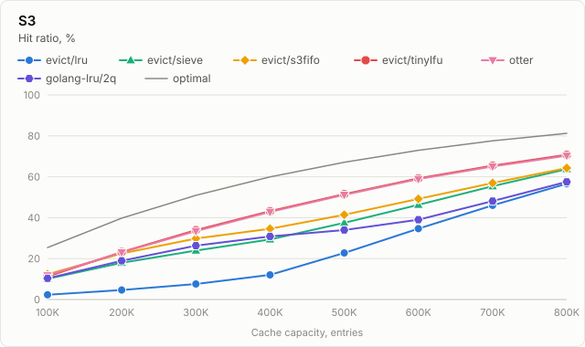
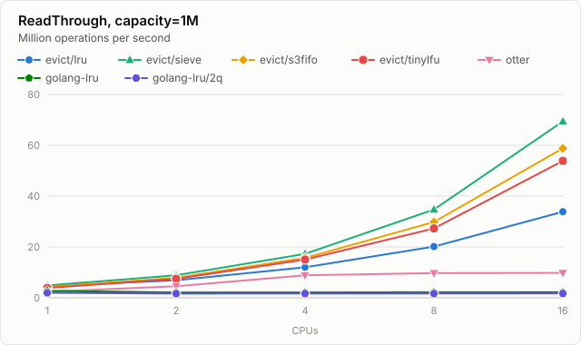

# evict

[](https://pkg.go.dev/github.com/floatdrop/evict)
[](https://github.com/floatdrop/evict/actions/workflows/ci.yml)
[](https://floatdrop.github.io/awesome-go/#floatdrop--evict)

Fixed-capacity in-memory caches for Go.

- **High hit ratio.** `tinylfu` uses frequency-based admission and adapts its queue sizes
  to the workload.
- **Reads that scale.** `tinylfu`, `s3fifo`, and `sieve` serve reads without locks.
- **No allocations after `New`.** Entries live in preallocated arrays that the GC skips
  when keys and values contain no pointers.

## Install

```
go get github.com/floatdrop/evict
```

Requires Go 1.26 or later.

## Usage

```go
package main

import (
	"fmt"

	"github.com/floatdrop/evict/tinylfu"
)

func main() {
	cache := tinylfu.New[string, int](10_000)

	cache.Set("a", 1)
	cache.Set("b", 2)

	if value, ok := cache.Get("a"); ok {
		fmt.Println(value)
	}

	// Set hands back what it pushed out: the previous entry for the key, or
	// the entry that was evicted to make room.
	if key, value, displaced := cache.Set("a", 10); displaced {
		fmt.Println("dropped", key, value)
	}

	// GetMany looks up a batch of keys. On a cache too large for the CPU's
	// caches, 32 keys per call take about half the time per key of Get.
	// For fewer than four keys, call Get.
	keys := []string{"a", "b", "c"}
	values := make([]int, len(keys))
	found := make([]bool, len(keys))
	cache.GetMany(keys, values, found)
	for i, key := range keys {
		if found[i] {
			fmt.Println(key, values[i])
		}
	}
}
```

Every package implements [`evict.Cache`](https://pkg.go.dev/github.com/floatdrop/evict#Cache),
`GetMany` included; `lru` takes a shard's lock once for the keys in a row that fall in it.

### Statistics

```go
cache := stats.Wrap(tinylfu.New[string, int](10_000))

s := cache.Stats()
fmt.Println(s.HitRatio(), s.Evictions, s.Len, s.Cap)
```

The counts only go up; `s.Sub(prev)` gives those of an interval. A `Get` that hits took
10–14% longer through the wrapper (`tinylfu`, Apple M3 Max).

### Expiry

```go
cache := expire.Wrap(tinylfu.New[string, expire.Entry[int]](10_000), time.Minute)

cache.Set("a", 1)                        // Expires in a minute,
cache.SetWithTTL("b", 2, 10*time.Second) // and this one in ten seconds.
```

Expired entries are misses but still count toward `Len`. Call `cache.PurgeExpired(nil)` to
remove them, or pass a function that releases what they hold.

Reads still count with the policy, even for expired entries. They look at a copy of the time
that a timer updates every 10 ms, and at the time itself near a deadline. A `Get` that hits
took 11–15% longer through the wrapper, and a `Set` 17 ns longer (`tinylfu`, Apple M3 Max).

### Loading

```go
// db.User(ctx, id) reads a user from the database.
users := load.Wrap(tinylfu.New[string, User](10_000), db.User)

u, err := users.Fetch(ctx, "42") // Loads 42 if the cache does not hold it.
```

`Fetch` calls for one key at the same time share a single load, and errors are not stored. A
`Set` or `Delete` through the wrapper during a load keeps it from storing what it read
before the change. What a load evicts, or loads after every caller gave up, reaches no `Set`
or `Fetch` caller: to release it, pass `load.WithDropped(func(key string, u User) { ... })`
to `Wrap`.

A `Fetch` that hits took 20–23% longer than a `Get`, and a `Set` 10 ns longer on one CPU and
60% longer on eight (`tinylfu`, Apple M3 Max).

### Values that have to be released

```go
cache := tinylfu.New[string, *ref.Ref[*os.File]](1000)

r := ref.New(f, func(f *os.File) { f.Close() })
if _, old, displaced := cache.Set(name, r); displaced {
	old.Drop() // Closes the old file once no reader has it.
}

if r, f, ok := ref.Get(cache, name); ok {
	defer r.Release()
	// ... use f ...
}
```

A goroutine that got a value from `Get` may still use it when `Set` hands it back. `ref`
counts the readers and releases the value when the last one lets go; a reader that comes
too late reads a miss. Every read writes the value's count: a `ref.Get` took 30–42% longer
than a `Get` over many keys, and 200–400 ns against 1.1 ns on eight CPUs that all read one
key.

## Benchmarks

<p>
  
  
</p>

- **Left:** requests answered on S3, disk reads of a search engine, by cache size. Caches
  in one shard; otter and `tinylfu` vary between replays, so theirs are medians of 11.
- **Right:** reads of a million entries that store the key on a miss, by number of CPUs,
  on 16 cores of an Intel Xeon (Ice Lake) under Linux, one thread of each.
- `otter` is otter v2; `golang-lru` and `golang-lru/2q` are hashicorp's.
- Averaged over 11 traces: `tinylfu` 47.9% of requests, otter 47.5%, `s3fifo` 44.8%,
  `lru` 36.6%. The gap between `tinylfu` and otter is within how much they vary between
  replays.
- `tinylfu` was designed on these traces. On 14 others, in a simulation not in this
  repository, it was level with S3-FIFO and W-TinyLFU.
- In the chart on the right, the lock-free caches do 5.5–7.1 times as many operations as
  otter on 16 CPUs, as otter gets little more done past 4. On 8 CPUs of an Apple M3 Max
  they do 2.1–2.4 times as many.
- Otter wins when 10–25% of the operations overwrite entries, on 8 CPUs of the M3 Max and
  on 16 of the Xeon. Its writes that replace entries get faster with more CPUs, three-fold
  from one to 16 on the Xeon; those of this module do not.
- 56–100 bytes per entry with `uint64` keys and values. A GC cycle with 10 million entries
  takes 0.2–0.3 ms, against 530 ms for otter.

[bench/README.md](bench/README.md) has the method, every table, and `make bench` to rerun
them.

## Choosing a policy

| Package | Use it when | Watch out for |
|:---|:---|:---|
| [`tinylfu`](https://pkg.go.dev/github.com/floatdrop/evict/tinylfu)<br>[TinyLFU](https://arxiv.org/abs/1512.00727) over S3-FIFO | **in doubt**: the workload is unknown, or has loops or scans, and is read far more than written | Evicting writes are 8–13% slower than in `s3fifo`. Hit ratios vary between runs by up to 5.6 points. Where keys come back once or twice after the same while, `lru` can do far better ([docs](https://pkg.go.dev/github.com/floatdrop/evict/tinylfu)). |
| [`s3fifo`](https://pkg.go.dev/github.com/floatdrop/evict/s3fifo)<br>[S3-FIFO](https://dl.acm.org/doi/10.1145/3600006.3613147) | you want the same results on every run, or the workload has no loops | On looping workloads it can fall as low as `lru`. Writes cost about twice what they do in `lru`. |
| [`sieve`](https://pkg.go.dev/github.com/floatdrop/evict/sieve)<br>[SIEVE](https://www.usenix.org/conference/nsdi24/presentation/zhang-yazhuo) | reading through has to be as fast as possible, and you have checked your workload | It can collapse on loops: on one trace it answers under 1% of requests where `lru` answers 44% ([when not to use it](https://pkg.go.dev/github.com/floatdrop/evict/sieve#hdr-When_not_to_use_it)). |
| [`lru`](https://pkg.go.dev/github.com/floatdrop/evict/lru)<br>least recently used | memory counts most, one goroutine uses it, or you want behavior everyone knows | The lowest hit ratio of these four on 9 of the 11 traces; reads take a lock. |

Every package takes `WithShards`. `s3fifo` also has options for tuning its queues
([what that is worth](bench/results/tuning.md)); `tinylfu` tunes its own.

## How it works

- **Arrays, not pointers.** Each shard allocates its nodes once and links them by 32-bit
  index. An open-addressing index with three slots per entry maps a 32-bit hash to a node,
  so a lookup compares hashes before it touches an entry.
- **Shards.** The upper half of a key's hash picks a shard, which writers lock on its own;
  the lower half indexes the key within it. Each shard evicts from its own share of the
  capacity. A cache under 512 entries is one shard; a larger one has up to eight per CPU, of
  256 entries or more. `WithShards(1)` gives a policy's textbook behavior.
- **Lock-free reads** (`sieve`, `s3fifo`, `tinylfu`). A reader pins the node it reads in a
  slot of its own and checks that the index still points there. Writers never change a node
  that a reader can reach: a new value goes into a fresh node, and a node is reused only
  once no slot pins it. A read writes only to a cache line its CPU has to itself. Removed
  entries stay referenced until their shard collects them in a batch (an eighth of its
  capacity, 1,024 at most); `Clear` lets go of everything. The slots take 2–4 KiB per CPU,
  so for very many small caches, use `lru`.
- **Admission** (`tinylfu`). Each shard keeps a count-min sketch of how often keys are
  asked for, cached or not; only writers update it, picking up the reads counted on
  entries. Once the shard is full, a new entry gets into the main queue only if the sketch
  rates its key above the entry that queue would evict next. The size of the small queue
  is tuned by hill climbing, as in Caffeine.
- **Tests.** Every cache runs one conformance suite, is checked against a simple model of
  its policy step by step, and is fuzzed against that model. Lock-free reads are tested
  under the race detector. `lru` must agree with hashicorp's `golang-lru` on every request
  of a trace.

## What it does not do

- **No sizes in bytes or weights.** Capacity counts entries; set it from a typical entry size.
- **No background expiry**: call `PurgeExpired` yourself ([Expiry](#expiry)).
- **Overwrites do not scale with CPUs.** From about 10% overwrites, otter is faster on 8 CPUs
  of the M3 Max and 16 of the Xeon ([Benchmarks](#benchmarks)).

## License

[MIT](LICENSE)
