# Hit ratios

The share of requests, in percent, that a cache of a given capacity answers when a
trace is replayed against it: every key of the trace is looked up in turn and stored if
it is missing. The column `optimal` is not a cache but the bound that no cache can
beat: what one would score that knew the requests to come.

The caches of this module run in one piece here, with a single shard, and otter evicts on
the spot rather than in the background, as it does in its own simulator. Most of the
caches then evict the same way every time, and their numbers are the same on every run.
Two do not. Otter admits some entries at random, and `evict/tinylfu` counts requests in a
sketch in which keys share counters, by a hash that is seeded at random. That moves their
hit ratios from one replay to the next, in this run by up to 5.6 percentage points (evict/tinylfu on Mixed with 750 entries).
Their numbers are the medians of 11 replays, which is also what the charts show, and the
column next to each has the lowest and the highest of them. That is not all the range
there is: of further replays, about 17 in a hundred would come out below it or above it.

A number is in bold if the cache did better in that row than every other one, on each of
their replays. Where the range of one cache reaches the best of the others, the row has no
winner.

A program does not get the caches of this module in one piece unless it asks for that: by
default they are split into shards. What difference that makes is in
[sharding.md](sharding.md). For most of the numbers here it is none to speak of, but not
for all: `evict/sieve` in particular does far better in shards on the traces on which it
does worst here.

Produced by `go run ./cmd/hitratio -out results` with go1.27.3, golang-lru v2.0.7, otter v2.4.0.

## At a glance

The hit ratio of every cache on every trace, averaged over the capacities at which the
trace was replayed. Averages hide a lot: a cache that leads here may trail at the capacity
that matters to you, so look at the trace that resembles your workload, below.

| trace | evict/lru | evict/twoq | evict/sieve | evict/s3fifo | evict/tinylfu | otter | golang-lru/2q | optimal |
|:---|---:|---:|---:|---:|---:|---:|---:|---:|
| Zipf | 29.97 | 36.53 | 37.55 | **38.25** | 37.66 | 37.90 | 37.61 | 44.07 |
| S3 | 23.33 | 32.78 | 35.54 | 38.90 | **44.83** | 44.57 | 33.15 | 59.37 |
| DS1 | 23.70 | 28.88 | 38.87 | 37.05 | **47.07** | 46.54 | 34.47 | 50.21 |
| OLTP | 32.40 | 39.07 | 30.60 | 39.11 | 38.76 | 38.97 | 37.60 | 52.77 |
| P8 | 24.10 | 32.11 | 27.66 | 35.31 | **37.86** | 36.20 | 31.45 | 53.53 |
| Glimpse | 21.81 | 27.40 | 30.14 | 43.24 | 45.20 | 45.28 | 33.20 | 47.81 |
| Mixed | 44.11 | 56.80 | 0.43 | 43.84 | 60.32 | **61.61** | 35.97 | 64.22 |
| Scarab | 59.10 | 61.00 | 60.53 | **61.60** | 60.31 | 58.99 | 61.14 | 70.30 |
| Twitter | 58.37 | 59.72 | 58.99 | **60.32** | 59.59 | 59.29 | 58.80 | 65.46 |
| MSR | 64.40 | 66.31 | 66.16 | **67.22** | 67.06 | 66.54 | 66.57 | 73.60 |
| CloudPhysics | 20.90 | 24.41 | 24.70 | 27.59 | 27.80 | 26.77 | 25.59 | 34.23 |

## Trace by trace

### Zipf

Synthetic: a million requests whose popularity follows a Zipf distribution (s = 1.0001, v = 10) over 50 million keys: 1,000,000 requests for 456,052 keys.
Trace: generated; the parameters are those of otter's benchmarks.

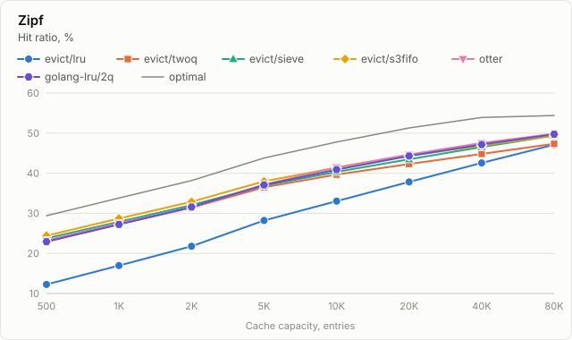

| capacity | evict/lru | evict/twoq | evict/sieve | evict/s3fifo | evict/tinylfu | evict/tinylfu, range | otter | otter, range | golang-lru/2q | optimal |
|---:|---:|---:|---:|---:|---:|---:|---:|---:|---:|---:|
| 500 | 12.25 | 22.98 | 23.77 | **24.41** | 22.01 | 20.98–22.25 | 23.18 | 21.88–23.72 | 22.93 | 29.40 |
| 1,000 | 16.96 | 27.25 | 27.88 | **28.70** | 26.84 | 26.80–26.87 | 27.63 | 26.50–27.83 | 27.22 | 33.81 |
| 2,000 | 21.78 | 31.41 | 32.06 | **32.88** | 31.20 | 31.12–31.36 | 31.81 | 31.10–32.17 | 31.58 | 38.17 |
| 5,000 | 28.22 | 36.51 | 36.90 | **38.00** | 37.45 | 37.37–37.48 | 37.26 | 36.47–37.74 | 37.08 | 43.80 |
| 10,000 | 33.04 | 39.66 | 40.34 | 41.39 | 41.44 | 41.38–41.46 | 41.40 | 41.20–41.63 | 40.88 | 47.79 |
| 20,000 | 37.83 | 42.30 | 43.49 | 44.32 | **44.85** | 44.81–44.87 | 44.55 | 44.33–44.79 | 44.30 | 51.29 |
| 40,000 | 42.58 | 44.82 | 46.54 | 46.90 | 47.65 | 47.62–47.67 | 47.48 | 47.37–47.65 | 47.16 | 53.91 |
| 80,000 | 47.11 | 47.35 | 49.39 | 49.40 | 49.87 | 49.85–49.90 | 49.85 | 49.52–49.90 | 49.73 | 54.39 |

### S3

Disk reads of a search engine: 16,407,702 requests for 1,689,882 keys.
Trace: Megiddo and Modha, "ARC: A Self-Tuning, Low Overhead Replacement Cache", FAST '03.

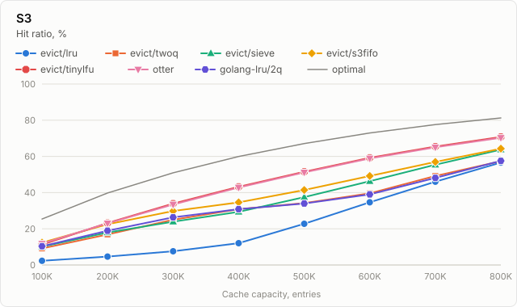

| capacity | evict/lru | evict/twoq | evict/sieve | evict/s3fifo | evict/tinylfu | evict/tinylfu, range | otter | otter, range | golang-lru/2q | optimal |
|---:|---:|---:|---:|---:|---:|---:|---:|---:|---:|---:|
| 100,000 | 2.33 | 9.15 | 10.12 | **12.34** | 11.27 | 11.10–11.30 | 11.83 | 11.69–11.88 | 10.35 | 25.42 |
| 200,000 | 4.63 | 16.86 | 17.93 | 22.52 | **23.23** | 23.21–23.29 | 23.03 | 23.01–23.07 | 18.94 | 39.79 |
| 300,000 | 7.59 | 25.01 | 23.94 | 29.81 | **33.94** | 33.87–33.97 | 33.45 | 33.10–33.53 | 26.36 | 50.92 |
| 400,000 | 12.04 | 30.87 | 29.36 | 34.62 | **43.23** | 43.15–43.28 | 42.81 | 42.73–42.88 | 30.87 | 59.96 |
| 500,000 | 22.77 | 34.20 | 37.51 | 41.42 | **51.53** | 51.48–51.60 | 51.15 | 51.10–51.23 | 33.99 | 67.09 |
| 600,000 | 34.63 | 39.59 | 46.27 | 49.21 | **59.26** | 59.20–59.34 | 58.86 | 58.76–58.93 | 39.01 | 72.97 |
| 700,000 | 46.04 | 49.20 | 55.40 | 56.97 | **65.46** | 65.37–65.54 | 65.06 | 64.99–65.10 | 48.12 | 77.57 |
| 800,000 | 56.60 | 57.38 | 63.76 | 64.31 | **70.75** | 70.65–70.82 | 70.32 | 70.24–70.39 | 57.55 | 81.27 |

### DS1

Disk reads of a database server that runs an ERP application, over seven days: 43,704,979 requests for 10,516,352 keys.
Trace: Megiddo and Modha, "ARC: A Self-Tuning, Low Overhead Replacement Cache", FAST '03.

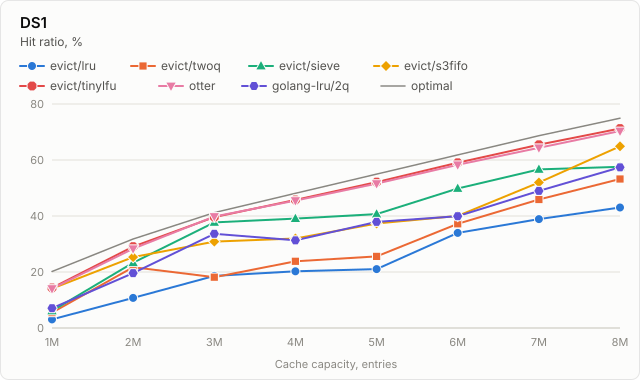

| capacity | evict/lru | evict/twoq | evict/sieve | evict/s3fifo | evict/tinylfu | evict/tinylfu, range | otter | otter, range | golang-lru/2q | optimal |
|---:|---:|---:|---:|---:|---:|---:|---:|---:|---:|---:|
| 1,000,000 | 3.09 | 5.51 | 6.12 | 14.09 | 14.31 | 14.05–14.63 | 14.06 | 13.85–14.14 | 7.08 | 20.19 |
| 2,000,000 | 10.74 | 21.70 | 23.32 | 25.32 | **29.06** | 28.89–29.15 | 28.32 | 28.23–28.43 | 19.59 | 31.79 |
| 3,000,000 | 18.59 | 18.14 | 37.73 | 30.85 | 39.59 | 39.37–39.87 | 39.84 | 39.72–39.92 | 33.65 | 41.23 |
| 4,000,000 | 20.24 | 23.81 | 39.07 | 31.96 | 45.75 | 45.55–45.92 | 45.51 | 45.34–45.69 | 31.31 | 48.09 |
| 5,000,000 | 21.03 | 25.57 | 40.66 | 37.31 | **52.09** | 51.84–52.30 | 51.56 | 51.40–51.65 | 37.89 | 54.96 |
| 6,000,000 | 33.95 | 37.21 | 49.81 | 40.03 | **59.05** | 58.69–59.09 | 58.30 | 58.14–58.40 | 39.94 | 61.82 |
| 7,000,000 | 38.90 | 45.88 | 56.65 | 51.97 | **65.47** | 65.29–65.56 | 64.34 | 64.12–64.73 | 48.96 | 68.69 |
| 8,000,000 | 43.03 | 53.22 | 57.57 | 64.91 | **71.23** | 71.01–71.36 | 70.36 | 70.31–70.43 | 57.38 | 74.93 |

### OLTP

References to a CODASYL database, over one hour: 914,145 requests for 186,880 keys.
Trace: Megiddo and Modha, "ARC: A Self-Tuning, Low Overhead Replacement Cache", FAST '03.

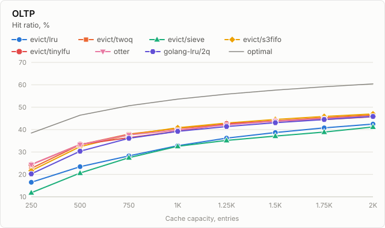

| capacity | evict/lru | evict/twoq | evict/sieve | evict/s3fifo | evict/tinylfu | evict/tinylfu, range | otter | otter, range | golang-lru/2q | optimal |
|---:|---:|---:|---:|---:|---:|---:|---:|---:|---:|---:|
| 250 | 16.47 | 22.70 | 11.81 | 21.65 | 24.41 | 23.73–24.81 | 24.34 | 23.64–24.59 | 20.23 | 38.47 |
| 500 | 23.45 | 33.28 | 20.62 | 32.40 | 33.38 | 32.95–33.59 | 33.27 | 32.97–33.60 | 30.37 | 46.43 |
| 750 | 28.28 | **37.99** | 27.46 | 37.70 | 36.40 | 36.36–36.43 | 37.63 | 36.80–37.91 | 36.10 | 50.67 |
| 1,000 | 32.83 | 40.53 | 32.56 | **40.82** | 39.28 | 39.24–39.31 | 39.82 | 39.69–40.08 | 39.24 | 53.62 |
| 1,250 | 36.21 | 42.38 | 35.18 | **42.91** | 42.57 | 42.56–42.60 | 42.13 | 41.23–42.52 | 41.37 | 55.84 |
| 1,500 | 38.70 | 43.88 | 37.10 | **44.53** | 43.82 | 43.76–43.86 | 43.74 | 43.41–44.15 | 43.09 | 57.62 |
| 1,750 | 40.79 | 45.32 | 38.91 | **45.88** | 44.46 | 44.42–44.51 | 44.92 | 44.86–44.98 | 44.51 | 59.13 |
| 2,000 | 42.47 | 46.51 | 41.19 | **46.99** | 45.76 | 45.71–45.78 | 45.94 | 45.85–46.34 | 45.87 | 60.40 |

### P8

Disk reads of a Windows NT workstation: 42,243,785 requests for 977,545 keys.
Trace: Megiddo and Modha, "ARC: A Self-Tuning, Low Overhead Replacement Cache", FAST '03.

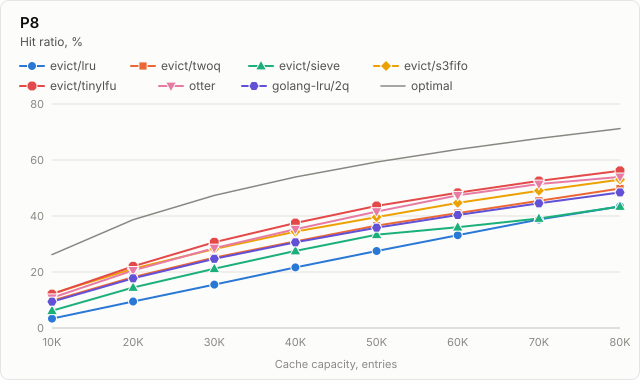

| capacity | evict/lru | evict/twoq | evict/sieve | evict/s3fifo | evict/tinylfu | evict/tinylfu, range | otter | otter, range | golang-lru/2q | optimal |
|---:|---:|---:|---:|---:|---:|---:|---:|---:|---:|---:|
| 10,000 | 3.34 | 9.76 | 6.19 | **12.29** | 12.09 | 11.03–12.18 | 10.77 | 9.40–12.01 | 9.39 | 26.22 |
| 20,000 | 9.48 | 18.17 | 14.48 | 21.20 | 22.04 | 20.70–22.70 | 20.58 | 18.99–21.37 | 17.74 | 38.69 |
| 30,000 | 15.49 | 25.16 | 21.17 | 28.23 | **30.66** | 30.09–31.08 | 28.55 | 25.76–29.89 | 24.73 | 47.37 |
| 40,000 | 21.63 | 30.94 | 27.55 | 34.43 | **37.50** | 37.41–37.56 | 35.30 | 32.81–36.23 | 30.59 | 53.94 |
| 50,000 | 27.51 | 36.56 | 33.33 | 39.62 | **43.60** | 42.96–43.66 | 41.59 | 40.74–42.24 | 35.81 | 59.29 |
| 60,000 | 33.13 | 41.02 | 36.01 | 44.67 | **48.34** | 48.30–48.42 | 47.38 | 47.03–47.52 | 40.36 | 63.77 |
| 70,000 | 38.75 | 45.42 | 39.12 | 49.02 | **52.54** | 52.48–52.71 | 51.44 | 49.64–51.75 | 44.53 | 67.72 |
| 80,000 | 43.45 | 49.81 | 43.39 | 53.01 | **56.16** | 56.02–56.40 | 53.96 | 52.67–54.68 | 48.42 | 71.21 |

### Glimpse

Block reads of the text search tool glimpse, which scans its files in loops: 6,015 requests for 2,529 keys.
Trace: Jiang and Zhang, "LIRS: An Efficient Low Inter-reference Recency Set Replacement Policy to Improve Buffer Cache Performance", SIGMETRICS '02.

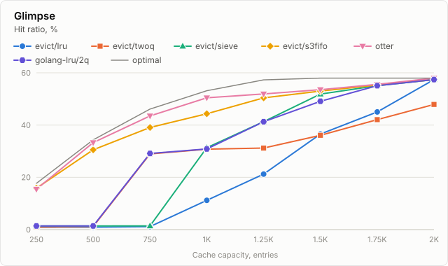

| capacity | evict/lru | evict/twoq | evict/sieve | evict/s3fifo | evict/tinylfu | evict/tinylfu, range | otter | otter, range | golang-lru/2q | optimal |
|---:|---:|---:|---:|---:|---:|---:|---:|---:|---:|---:|
| 250 | 0.91 | 1.00 | 1.38 | 15.83 | 14.41 | 12.52–16.28 | 15.30 | 15.01–16.11 | 1.38 | 17.71 |
| 500 | 0.95 | 1.18 | 1.38 | 30.54 | 33.28 | 32.97–33.43 | 33.42 | 32.98–33.53 | 1.40 | 34.33 |
| 750 | 1.15 | 28.96 | 1.41 | 39.09 | 43.69 | 41.98–43.74 | 43.29 | 41.70–43.57 | 29.14 | 46.13 |
| 1,000 | 11.21 | 30.77 | 31.34 | 44.34 | 50.77 | 49.91–50.99 | 50.82 | 49.89–50.89 | 30.86 | 53.15 |
| 1,250 | 21.25 | 31.21 | 41.31 | 50.42 | 52.09 | 52.04–52.62 | 52.29 | 51.85–52.44 | 41.26 | 57.31 |
| 1,500 | 36.56 | 36.08 | 51.85 | 53.00 | 53.55 | 53.55–53.58 | 53.57 | 53.55–53.58 | 49.09 | 57.96 |
| 1,750 | 45.04 | 42.08 | 55.06 | 55.33 | **55.88** | 55.88–55.89 | 55.58 | 55.58–55.59 | 55.06 | 57.96 |
| 2,000 | 57.41 | 47.90 | 57.41 | 57.41 | 57.96 | 57.96–57.96 | 57.96 | 57.96–57.96 | 57.41 | 57.96 |

### Mixed

Three workloads in a row: the vault service of a node of the Corda ledger, a program that reads its blocks in a loop, and the vault service once more: 776,904 requests for 91,479 keys.
Trace: R3, by way of the simulator of Caffeine, and Jiang and Zhang, the authors of LIRS; strung together as in otter's benchmarks.

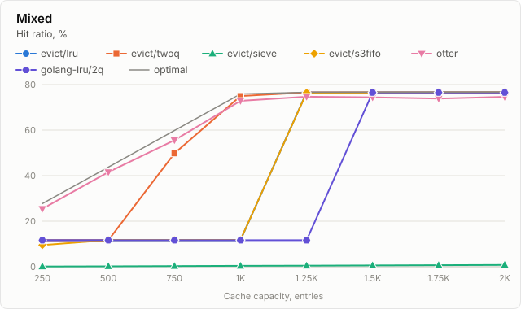

| capacity | evict/lru | evict/twoq | evict/sieve | evict/s3fifo | evict/tinylfu | evict/tinylfu, range | otter | otter, range | golang-lru/2q | optimal |
|---:|---:|---:|---:|---:|---:|---:|---:|---:|---:|---:|
| 250 | 11.64 | 11.64 | 0.10 | 9.50 | 24.27 | 23.28–24.99 | **25.65** | 25.04–25.87 | 11.64 | 27.70 |
| 500 | 11.64 | 11.64 | 0.19 | 11.70 | 40.19 | 38.13–41.52 | 41.54 | 40.87–42.17 | 11.64 | 43.76 |
| 750 | 11.64 | 49.80 | 0.29 | 11.73 | 55.75 | 50.84–56.40 | 55.44 | 54.71–56.04 | 11.64 | 59.82 |
| 1,000 | 11.64 | **74.96** | 0.39 | 11.76 | 69.67 | 69.65–69.73 | 72.70 | 72.32–72.94 | 11.64 | 75.87 |
| 1,250 | 76.58 | 76.58 | 0.48 | 76.44 | 74.23 | 74.10–74.32 | 74.69 | 74.35–74.80 | 11.64 | 76.61 |
| 1,500 | 76.58 | 76.58 | 0.58 | 76.49 | 72.37 | 72.32–74.00 | 74.40 | 74.29–74.45 | 76.50 | 76.64 |
| 1,750 | 76.58 | 76.58 | 0.67 | 76.54 | 72.91 | 71.48–73.61 | 73.91 | 73.62–74.01 | 76.51 | 76.68 |
| 2,000 | 76.58 | 76.58 | 0.77 | 76.58 | 73.21 | 73.14–73.30 | 74.58 | 74.49–74.66 | 76.51 | 76.71 |

### Scarab

Lookups of an e-commerce recommendation service, over one hour: 1,245,184 requests for 258,368 keys.
Trace: Scarab Research, by way of the simulator of Caffeine.

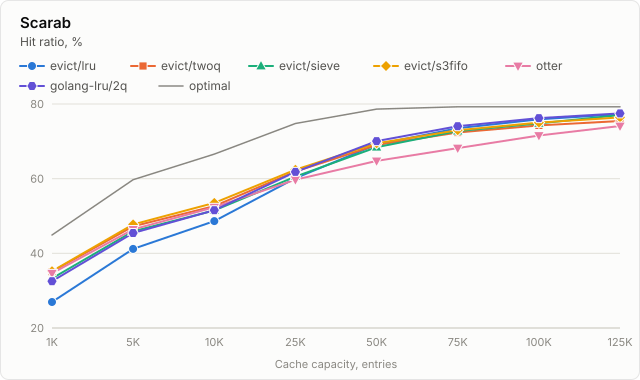

| capacity | evict/lru | evict/twoq | evict/sieve | evict/s3fifo | evict/tinylfu | evict/tinylfu, range | otter | otter, range | golang-lru/2q | optimal |
|---:|---:|---:|---:|---:|---:|---:|---:|---:|---:|---:|
| 1,000 | 26.96 | 35.10 | 33.28 | **35.22** | 34.75 | 34.65–34.95 | 34.94 | 34.12–35.06 | 32.53 | 44.91 |
| 5,000 | 41.20 | 47.24 | 45.90 | **47.75** | 47.45 | 47.43–47.54 | 46.37 | 46.28–46.99 | 45.44 | 59.72 |
| 10,000 | 48.65 | 52.64 | 51.51 | **53.51** | 52.84 | 52.80–52.86 | 52.32 | 51.99–52.39 | 51.55 | 66.57 |
| 25,000 | 60.13 | 61.92 | 60.56 | **62.41** | 60.69 | 60.62–60.74 | 59.73 | 59.64–59.81 | 61.81 | 74.79 |
| 50,000 | 69.15 | 69.01 | 68.43 | 69.47 | 66.93 | 66.87–66.96 | 64.73 | 64.67–64.82 | **70.07** | 78.63 |
| 75,000 | 73.51 | 72.37 | 72.74 | 72.99 | 70.79 | 70.76–70.83 | 68.17 | 68.08–68.22 | **74.05** | 79.25 |
| 100,000 | 75.91 | 74.26 | 74.80 | 75.03 | 73.49 | 73.45–73.50 | 71.56 | 71.48–71.60 | **76.23** | 79.25 |
| 125,000 | 77.27 | 75.44 | 77.04 | 76.40 | 75.53 | 75.51–75.56 | 74.13 | 74.08–74.21 | **77.47** | 79.25 |

### Twitter

Requests to an in-memory key-value cache at Twitter (cluster 45, a sample of one key in a hundred): 2,245,093 requests for 654,573 keys.
Trace: Yang, Yue and Rashmi, "A large scale analysis of hundreds of in-memory cache clusters at Twitter", OSDI '20; in the format of libCacheSim, https://github.com/cacheMon/cache_dataset (CC BY 4.0).

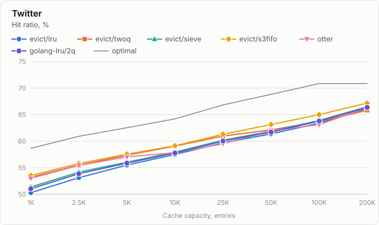

| capacity | evict/lru | evict/twoq | evict/sieve | evict/s3fifo | evict/tinylfu | evict/tinylfu, range | otter | otter, range | golang-lru/2q | optimal |
|---:|---:|---:|---:|---:|---:|---:|---:|---:|---:|---:|
| 1,000 | 50.28 | 53.20 | 51.36 | **53.52** | 52.96 | 52.88–52.97 | 53.04 | 52.89–53.27 | 51.02 | 58.65 |
| 2,500 | 53.12 | 55.49 | 54.16 | **55.78** | 55.22 | 55.21–55.31 | 55.44 | 55.16–55.51 | 53.86 | 60.92 |
| 5,000 | 55.49 | 57.37 | 56.03 | **57.55** | 56.95 | 56.94–56.96 | 57.03 | 56.83–57.16 | 55.86 | 62.54 |
| 10,000 | 57.49 | 59.07 | 57.94 | **59.13** | 58.50 | 58.50–58.52 | 57.84 | 57.34–58.64 | 57.77 | 64.20 |
| 25,000 | 59.69 | 60.98 | 60.16 | **61.29** | 60.42 | 60.41–60.43 | 59.51 | 59.45–59.53 | 60.02 | 66.83 |
| 50,000 | 61.37 | 62.12 | 61.88 | **63.13** | 62.18 | 62.17–62.19 | 62.00 | 61.97–62.02 | 61.69 | 68.82 |
| 100,000 | 63.39 | 63.72 | 63.89 | **65.00** | 64.03 | 64.01–64.04 | 63.11 | 63.08–63.12 | 63.79 | 70.84 |
| 200,000 | 66.15 | 65.82 | 66.48 | **67.17** | 66.50 | 66.49–66.51 | 66.37 | 66.36–66.39 | 66.36 | 70.84 |

### MSR

Block I/O of a hardware monitoring server at Microsoft Research Cambridge (volume hm_0): 3,993,316 requests for 439,187 keys.
Trace: Narayanan, Donnelly and Rowstron, "Write Off-Loading: Practical Power Management for Enterprise Storage", FAST '08; in the format of libCacheSim, https://github.com/cacheMon/cache_dataset (CC BY 4.0).

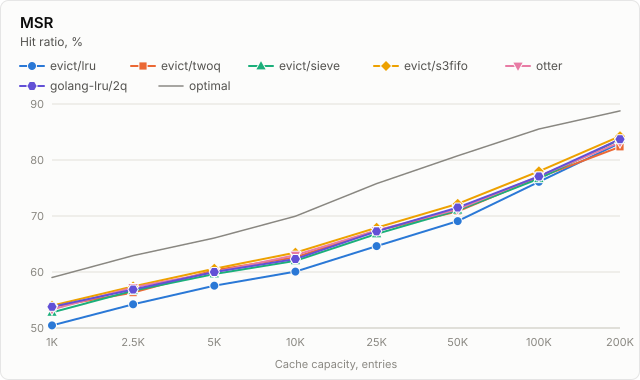

| capacity | evict/lru | evict/twoq | evict/sieve | evict/s3fifo | evict/tinylfu | evict/tinylfu, range | otter | otter, range | golang-lru/2q | optimal |
|---:|---:|---:|---:|---:|---:|---:|---:|---:|---:|---:|
| 1,000 | 50.47 | 53.78 | 52.78 | **53.99** | 53.51 | 53.25–53.58 | 53.32 | 52.91–53.47 | 53.79 | 59.02 |
| 2,500 | 54.23 | 56.31 | 56.67 | 57.43 | **57.82** | 57.55–57.84 | 57.25 | 56.54–57.33 | 56.88 | 62.94 |
| 5,000 | 57.56 | 60.33 | 59.63 | **60.59** | 59.84 | 59.82–59.89 | 59.78 | 59.70–59.98 | 60.00 | 66.07 |
| 10,000 | 60.08 | 62.62 | 62.01 | **63.46** | 63.23 | 63.19–63.27 | 63.07 | 63.01–63.14 | 62.31 | 69.96 |
| 25,000 | 64.63 | 67.40 | 66.80 | 67.91 | **68.07** | 68.00–68.11 | 67.41 | 67.36–67.49 | 67.26 | 75.78 |
| 50,000 | 69.08 | 70.81 | 71.01 | 72.17 | **72.36** | 72.33–72.39 | 71.19 | 71.16–71.24 | 71.52 | 80.75 |
| 100,000 | 76.11 | 76.90 | 76.66 | **77.99** | 77.84 | 77.82–77.88 | 77.12 | 77.05–77.18 | 77.06 | 85.54 |
| 200,000 | 83.03 | 82.36 | 83.70 | **84.24** | 83.79 | 83.73–83.83 | 83.16 | 83.14–83.19 | 83.71 | 88.76 |

### CloudPhysics

Block I/O of a virtual machine (trace w105): 3,375,344 requests for 654,126 keys.
Trace: Waldspurger, Park, Garthwaite and Ahmad, "Efficient MRC Construction with SHARDS", FAST '15; in the format of libCacheSim, https://github.com/cacheMon/cache_dataset (CC BY 4.0).

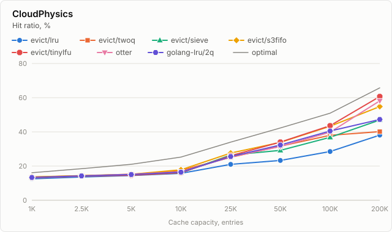

| capacity | evict/lru | evict/twoq | evict/sieve | evict/s3fifo | evict/tinylfu | evict/tinylfu, range | otter | otter, range | golang-lru/2q | optimal |
|---:|---:|---:|---:|---:|---:|---:|---:|---:|---:|---:|
| 1,000 | 12.53 | 13.56 | 13.14 | **13.65** | 13.13 | 13.06–13.18 | 13.25 | 13.13–13.41 | 13.32 | 16.11 |
| 2,500 | 13.59 | 14.31 | 14.23 | **14.44** | 14.06 | 14.01–14.08 | 14.25 | 14.24–14.29 | 14.26 | 18.45 |
| 5,000 | 14.46 | 15.09 | 14.83 | 15.22 | 14.65 | 14.63–14.69 | 15.26 | 14.81–15.45 | 15.05 | 21.04 |
| 10,000 | 15.75 | 17.41 | 16.03 | **17.84** | 16.08 | 15.94–16.23 | 16.63 | 16.48–17.20 | 16.44 | 25.25 |
| 25,000 | 21.01 | 25.11 | 26.46 | **27.62** | 26.08 | 25.84–26.28 | 25.29 | 23.94–25.40 | 25.55 | 34.01 |
| 50,000 | 23.28 | 31.65 | 29.16 | 33.87 | 34.05 | 33.78–34.27 | 31.47 | 30.69–31.80 | 32.33 | 42.28 |
| 100,000 | 28.48 | 37.99 | 36.83 | 43.28 | **43.62** | 43.43–44.02 | 39.84 | 39.48–40.32 | 40.49 | 50.92 |
| 200,000 | 38.09 | 40.14 | 46.93 | 54.81 | **60.68** | 59.85–60.85 | 58.14 | 57.75–58.82 | 47.26 | 65.73 |
