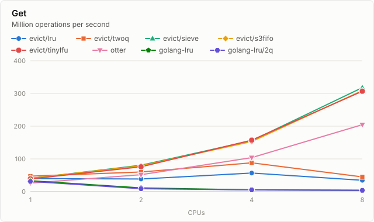
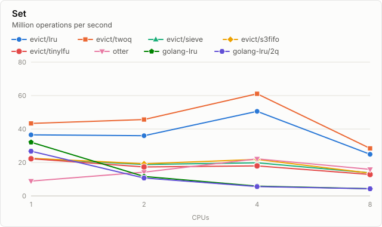
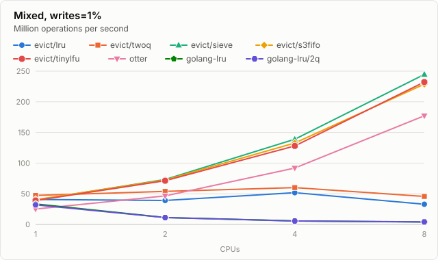
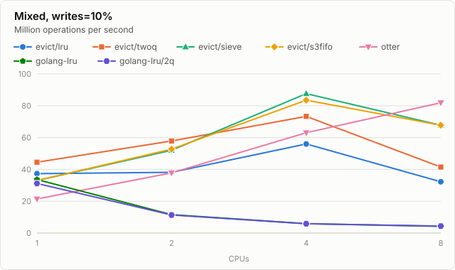
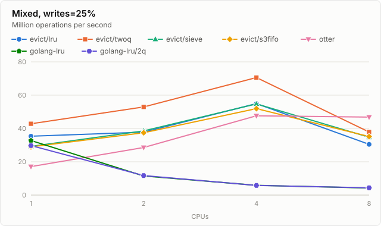
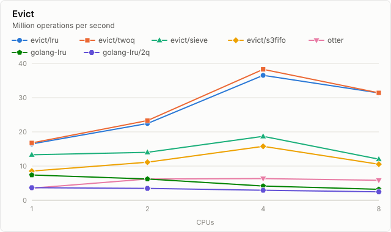
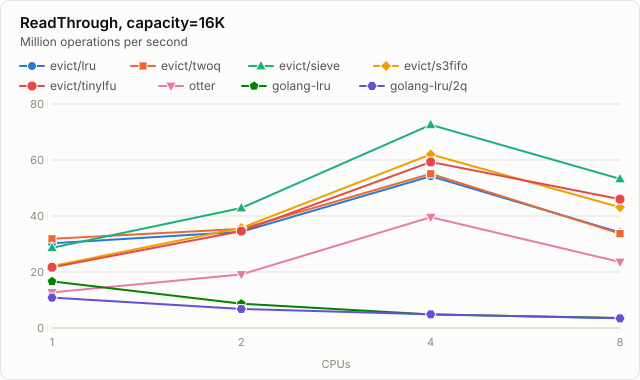
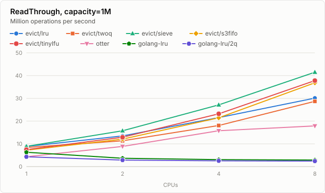

# Throughput

Millions of operations per second that all goroutines together get done on one cache,
with as many goroutines as CPUs. A number is the median of the runs, and the brackets
behind it hold the slowest and the fastest run. It is in bold if even the slowest run of
that cache beat the fastest of every other one; where the ranges overlap, or where there
are fewer than three runs to go by, the row has no winner. Benchmarks in which a cache can
miss have a second table, with the share of the reads that it answered.

Every cache is set up the way its library suggests, anew for every number of CPUs. See
throughput_test.go for what the benchmarks do, and throughput.txt for the output this
was made from.

Measured on Apple M3 Max (darwin/arm64) with go1.27.3, otter v2.4.0, golang-lru v2.0.7.

### Get

| CPUs | evict/lru | evict/twoq | evict/sieve | evict/s3fifo | otter | golang-lru | golang-lru/2q |
|---:|---:|---:|---:|---:|---:|---:|---:|
| 1 | 37.0 (34.0–38.5) | **48.3** (43.4–49.7) | 35.0 (34.4–36.8) | 36.2 (33.0–37.2) | 26.6 (24.3–27.4) | 33.6 (33.4–35.2) | 32.7 (32.2–33.8) |
| 2 | 38.1 (37.6–39.6) | 60.6 (57.3–62.2) | 68.6 (65.7–70.6) | 68.6 (64.9–70.3) | 51.2 (50.5–51.8) | 11.7 (11.0–11.8) | 11.4 (11.3–12.0) |
| 4 | 57.9 (54.3–59.8) | 88.7 (85.3–99.4) | 132.3 (93.8–141.7) | 143.8 (141.4–145.9) | 103.7 (102.8–103.9) | 5.9 (5.6–6.0) | 5.9 (5.5–6.0) |
| 8 | 36.4 (32.4–38.6) | 47.3 (46.1–48.1) | 278.0 (263.2–280.7) | 276.6 (232.6–285.2) | 205.3 (204.8–209.2) | 4.1 (4.0–4.5) | 4.2 (4.2–4.4) |

Every read was answered, by every cache.

### Set

| CPUs | evict/lru | evict/twoq | evict/sieve | evict/s3fifo | otter | golang-lru | golang-lru/2q |
|---:|---:|---:|---:|---:|---:|---:|---:|
| 1 | 35.9 (34.4–37.1) | **43.4** (39.6–44.8) | 21.9 (21.2–22.5) | 21.7 (21.1–21.9) | 8.6 (8.5–8.9) | 31.7 (30.1–33.5) | 26.5 (25.3–27.8) |
| 2 | 35.9 (35.4–36.3) | **45.5** (43.7–46.9) | 18.1 (17.6–18.8) | 18.1 (17.3–18.3) | 13.6 (12.5–14.2) | 11.2 (10.9–11.7) | 10.9 (10.1–11.7) |
| 4 | 49.0 (43.5–50.0) | 58.8 (46.7–66.6) | 19.3 (17.1–20.6) | 19.2 (15.8–21.0) | 20.9 (17.8–22.0) | 5.7 (5.6–5.9) | 5.5 (5.3–5.7) |
| 8 | 25.3 (23.6–27.0) | 29.3 (26.3–30.2) | 12.9 (11.1–13.6) | 13.1 (12.6–13.8) | 15.7 (15.4–15.9) | 4.2 (3.9–4.3) | 4.2 (3.9–4.4) |

### Mixed, writes=1%

| CPUs | evict/lru | evict/twoq | evict/sieve | evict/s3fifo | otter | golang-lru | golang-lru/2q |
|---:|---:|---:|---:|---:|---:|---:|---:|
| 1 | 38.0 (35.8–39.6) | **47.5** (42.0–49.6) | 35.1 (32.0–37.5) | 35.7 (34.3–36.6) | 26.0 (24.4–26.5) | 34.2 (33.4–34.8) | 32.7 (31.4–33.3) |
| 2 | 38.0 (36.9–39.8) | 58.4 (55.2–61.8) | 66.5 (62.2–69.1) | 66.9 (65.0–68.6) | 47.9 (46.3–48.4) | 11.4 (11.2–11.7) | 11.7 (11.4–11.8) |
| 4 | 58.7 (52.5–60.0) | 71.1 (54.0–87.7) | 118.3 (112.9–126.6) | 87.0 (84.2–124.9) | 90.8 (86.9–93.7) | 5.8 (5.5–5.9) | 5.9 (5.7–5.9) |
| 8 | 35.1 (29.4–37.6) | 45.5 (43.3–47.7) | 189.5 (156.9–198.7) | 207.8 (160.4–213.0) | 176.5 (172.7–176.9) | 4.3 (4.1–4.4) | 4.3 (4.2–4.4) |

### Mixed, writes=10%

| CPUs | evict/lru | evict/twoq | evict/sieve | evict/s3fifo | otter | golang-lru | golang-lru/2q |
|---:|---:|---:|---:|---:|---:|---:|---:|
| 1 | 37.3 (35.4–38.8) | **44.5** (39.7–47.9) | 33.0 (30.6–33.7) | 33.0 (30.2–34.2) | 21.4 (19.8–21.8) | 33.6 (32.5–34.3) | 31.2 (30.2–31.9) |
| 2 | 38.2 (36.9–38.7) | **57.9** (54.1–59.1) | 52.0 (47.0–52.6) | 52.7 (52.1–53.8) | 37.8 (35.8–38.1) | 11.6 (11.1–11.8) | 11.3 (11.3–11.8) |
| 4 | 56.0 (51.4–59.0) | 73.3 (42.4–87.9) | 87.6 (71.5–91.7) | 83.5 (81.5–91.8) | 63.0 (61.5–67.8) | 5.9 (5.4–6.2) | 5.9 (5.8–6.0) |
| 8 | 32.2 (28.5–33.8) | 41.5 (39.2–43.7) | 67.7 (65.6–71.7) | 67.8 (64.4–70.0) | **81.9** (80.7–82.4) | 4.2 (4.0–4.4) | 4.4 (4.1–4.5) |

### Mixed, writes=25%

| CPUs | evict/lru | evict/twoq | evict/sieve | evict/s3fifo | otter | golang-lru | golang-lru/2q |
|---:|---:|---:|---:|---:|---:|---:|---:|
| 1 | 35.4 (33.5–37.0) | **42.8** (40.2–43.0) | 29.2 (26.5–30.1) | 29.0 (28.1–30.6) | 17.1 (16.8–17.4) | 32.8 (32.3–33.1) | 29.7 (29.5–30.3) |
| 2 | 37.8 (36.3–38.1) | **52.9** (49.7–54.7) | 38.5 (30.7–39.1) | 37.4 (36.5–38.3) | 28.6 (27.3–28.8) | 11.5 (11.4–11.8) | 11.7 (11.3–11.8) |
| 4 | 54.9 (51.9–58.6) | **70.6** (63.9–72.0) | 54.8 (51.6–59.3) | 51.9 (44.0–55.7) | 47.6 (45.7–48.9) | 5.8 (5.7–5.9) | 5.8 (5.7–5.8) |
| 8 | 30.5 (26.6–34.4) | 37.9 (37.0–38.2) | 34.7 (33.8–37.2) | 35.1 (34.2–36.6) | **46.8** (46.2–47.0) | 4.2 (4.0–4.4) | 4.4 (4.0–4.4) |

### Evict

| CPUs | evict/lru | evict/twoq | evict/sieve | evict/s3fifo | otter | golang-lru | golang-lru/2q |
|---:|---:|---:|---:|---:|---:|---:|---:|
| 1 | 16.5 (15.9–16.7) | 16.8 (16.6–16.9) | 13.3 (13.1–13.5) | 8.5 (8.4–8.6) | 3.5 (3.5–3.6) | 7.4 (7.3–7.5) | 3.7 (3.2–3.8) |
| 2 | 22.4 (21.5–22.7) | **23.3** (23.2–23.8) | 14.0 (13.8–14.1) | 11.1 (10.9–11.2) | 6.2 (5.8–6.3) | 6.2 (6.0–6.3) | 3.5 (2.9–3.6) |
| 4 | 36.5 (32.4–36.9) | **38.3** (37.9–38.9) | 18.7 (18.4–18.9) | 15.8 (14.5–16.1) | 6.3 (6.3–6.6) | 4.2 (4.0–4.4) | 2.9 (2.8–3.1) |
| 8 | 31.4 (30.9–32.1) | 31.4 (30.3–32.0) | 12.0 (11.6–12.2) | 10.5 (10.2–10.6) | 5.8 (5.0–6.2) | 3.2 (3.2–3.3) | 2.5 (2.3–2.8) |

### ReadThrough, capacity=16K

| CPUs | evict/lru | evict/twoq | evict/sieve | evict/s3fifo | otter | golang-lru | golang-lru/2q |
|---:|---:|---:|---:|---:|---:|---:|---:|
| 1 | 30.1 (28.5–30.3) | **31.6** (31.1–31.9) | 28.5 (28.3–28.9) | 21.9 (21.7–22.0) | 12.4 (11.4–12.7) | 16.5 (15.0–17.5) | 10.0 (9.4–11.2) |
| 2 | 33.4 (33.2–34.6) | 34.2 (33.8–34.6) | **42.7** (41.0–43.2) | 36.0 (32.8–36.5) | 18.7 (17.6–19.0) | 8.6 (8.4–8.8) | 6.7 (6.5–6.8) |
| 4 | 49.3 (47.3–54.5) | 48.4 (43.8–55.4) | **69.4** (64.0–73.3) | 60.6 (58.1–62.9) | 38.8 (24.2–41.6) | 4.8 (4.7–4.8) | 4.7 (4.6–4.9) |
| 8 | 34.5 (33.0–36.1) | 34.8 (31.1–35.7) | **52.1** (51.4–53.2) | 43.2 (42.1–43.6) | 23.6 (21.6–26.1) | 3.5 (3.4–3.6) | 3.4 (3.3–3.5) |

Share of the reads that were answered, in percent:

| CPUs | evict/lru | evict/twoq | evict/sieve | evict/s3fifo | otter | golang-lru | golang-lru/2q |
|---:|---:|---:|---:|---:|---:|---:|---:|
| 1 | 84.0 | 85.6 | 87.7 | 86.8 | 87.0 | 84.0 | 85.3 |
| 2 | 84.0 | 85.6 | 87.8 | 86.8 | 87.2 | 84.0 | 85.3 |
| 4 | 84.0 | 85.6 | 87.8 | 86.8 | 87.5 | 84.0 | 85.3 |
| 8 | 84.0 | 85.5 | 87.7 | 86.8 | 87.6 | 84.0 | 85.3 |

### ReadThrough, capacity=1M

| CPUs | evict/lru | evict/twoq | evict/sieve | evict/s3fifo | otter | golang-lru | golang-lru/2q |
|---:|---:|---:|---:|---:|---:|---:|---:|
| 1 | 8.9 (7.5–9.1) | 7.8 (6.4–8.5) | 8.4 (7.8–9.2) | 7.3 (6.0–7.7) | 4.1 (3.7–4.5) | 6.2 (5.7–6.4) | 4.2 (3.8–4.4) |
| 2 | 12.7 (12.4–13.3) | 11.6 (9.4–12.0) | **15.4** (14.2–16.3) | 12.8 (12.3–12.9) | 8.9 (8.3–9.3) | 3.5 (3.0–3.7) | 2.8 (2.5–2.9) |
| 4 | 17.2 (16.2–21.6) | 15.7 (13.5–18.8) | 26.8 (18.9–28.4) | 22.5 (17.2–23.2) | 15.3 (13.7–15.9) | 3.0 (2.7–3.2) | 2.5 (2.3–2.6) |
| 8 | 29.4 (29.0–30.6) | 28.6 (28.3–28.8) | **41.6** (38.6–42.5) | 37.0 (34.6–37.2) | 17.7 (17.5–18.9) | 2.8 (2.6–3.0) | 2.4 (2.2–2.5) |

Share of the reads that were answered, in percent:

| CPUs | evict/lru | evict/twoq | evict/sieve | evict/s3fifo | otter | golang-lru | golang-lru/2q |
|---:|---:|---:|---:|---:|---:|---:|---:|
| 1 | 88.4 | 88.9 | 89.8 | 89.8 | 89.6 | 88.4 | 89.4 |
| 2 | 88.5 | 89.1 | 89.9 | 90.0 | 89.6 | 88.4 | 89.4 |
| 4 | 88.4 | 89.3 | 90.0 | 90.1 | 89.8 | 88.4 | 89.4 |
| 8 | 88.4 | 89.4 | 90.1 | 90.2 | 89.8 | 88.4 | 89.4 |
