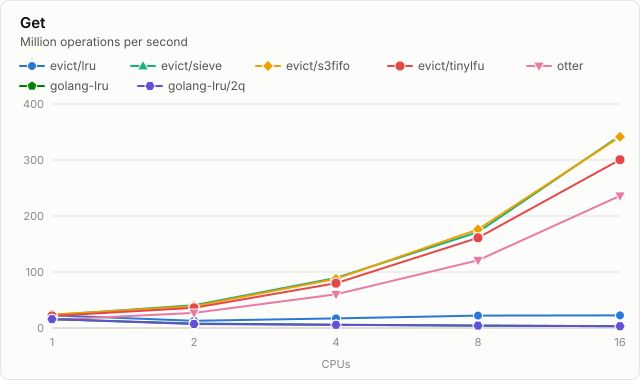
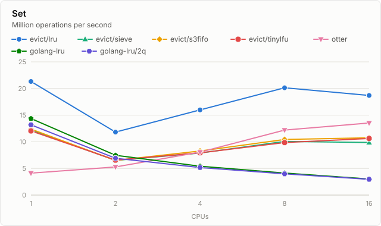
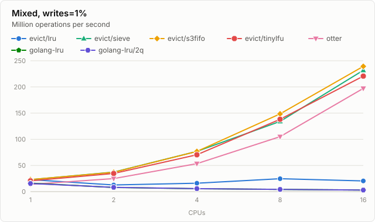
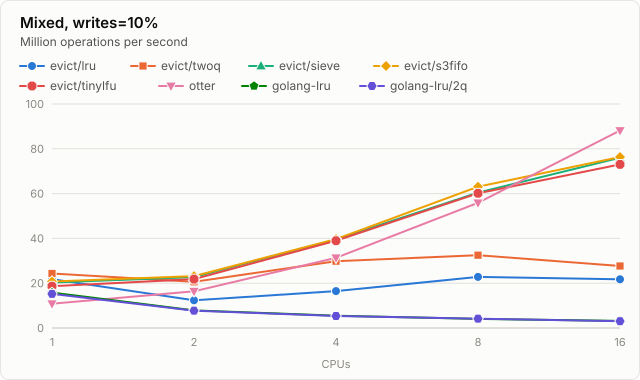
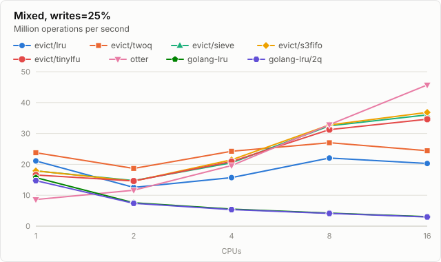
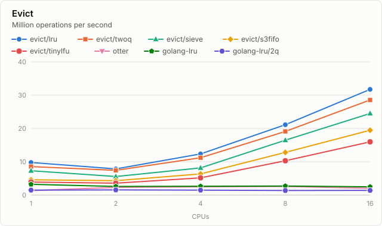
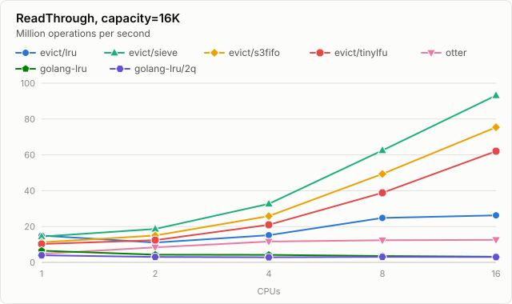
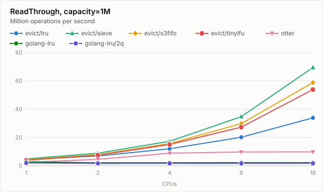

# Throughput

Millions of operations per second that all goroutines together get done on one cache,
with as many goroutines as CPUs. A number is the median of the runs, and the brackets
behind it hold the slowest and the fastest run. It is in bold if even the slowest run of
that cache beat the fastest of every other one; where the ranges overlap, or where there
are fewer than three runs to go by, the row has no winner. Benchmarks in which a cache can
miss have a second table, with the share of the reads that it answered.

Every cache is set up the way its library suggests, anew for every number of CPUs. See
throughput_test.go for what the benchmarks do, and throughput.txt for the output this
was made from.

Measured on Intel Xeon Processor (Icelake) (linux/amd64) with go1.27.3, otter v2.4.0, golang-lru v2.0.7.

### Get

| CPUs | evict/lru | evict/sieve | evict/s3fifo | evict/tinylfu | otter | golang-lru | golang-lru/2q |
|---:|---:|---:|---:|---:|---:|---:|---:|
| 1 | 22.6 (22.0–23.5) | 23.3 (22.6–23.9) | 23.9 (21.7–24.4) | 21.6 (20.4–21.8) | 14.8 (14.1–15.3) | 15.7 (15.3–16.4) | 15.9 (15.6–16.2) |
| 2 | 12.9 (12.6–13.2) | 40.7 (38.2–42.6) | 38.9 (18.8–42.6) | 36.1 (31.6–38.2) | 27.0 (22.9–28.6) | 7.8 (7.2–8.2) | 7.1 (6.1–8.6) |
| 4 | 17.1 (15.7–17.7) | 89.5 (88.1–91.7) | 87.8 (64.6–89.1) | 79.9 (79.5–82.0) | 60.2 (59.9–60.5) | 5.8 (5.3–6.0) | 5.5 (5.3–5.8) |
| 8 | 22.1 (18.2–24.1) | 171.3 (149.2–185.6) | 176.0 (167.8–184.2) | 161.1 (157.5–163.7) | 120.9 (119.1–122.2) | 4.2 (4.2–4.4) | 4.2 (4.0–4.3) |
| 16 | 22.6 (21.2–25.6) | 343.4 (263.3–358.8) | 341.5 (317.5–353.6) | 300.6 (283.9–320.0) | 236.0 (221.7–245.1) | 3.1 (3.0–3.2) | 3.1 (3.1–3.2) |

Every read was answered, by every cache.

### Set

| CPUs | evict/lru | evict/sieve | evict/s3fifo | evict/tinylfu | otter | golang-lru | golang-lru/2q |
|---:|---:|---:|---:|---:|---:|---:|---:|
| 1 | **21.3** (19.9–21.6) | 12.2 (12.1–12.4) | 12.4 (12.2–12.5) | 12.0 (11.6–12.3) | 4.1 (4.1–4.2) | 14.4 (13.5–15.8) | 13.2 (10.3–13.6) |
| 2 | **11.8** (11.3–11.9) | 6.5 (6.3–6.6) | 6.5 (6.4–6.8) | 6.6 (6.3–6.7) | 5.3 (5.1–5.3) | 7.5 (6.9–7.6) | 6.9 (6.2–7.6) |
| 4 | **16.0** (14.5–16.1) | 7.9 (7.6–8.0) | 8.3 (7.5–8.5) | 7.9 (7.4–8.1) | 8.1 (7.8–8.3) | 5.4 (5.0–5.5) | 5.2 (5.0–5.2) |
| 8 | **20.1** (16.0–20.3) | 10.1 (9.8–10.3) | 10.4 (9.6–10.6) | 9.9 (9.2–10.4) | 12.2 (11.9–12.6) | 4.1 (3.8–4.2) | 4.0 (3.9–4.1) |
| 16 | **18.7** (16.2–19.8) | 9.9 (8.1–10.5) | 10.8 (10.6–10.9) | 10.6 (9.7–10.7) | 13.5 (13.2–13.6) | 3.0 (2.9–3.1) | 3.0 (2.9–3.0) |

### Mixed, writes=1%

| CPUs | evict/lru | evict/sieve | evict/s3fifo | evict/tinylfu | otter | golang-lru | golang-lru/2q |
|---:|---:|---:|---:|---:|---:|---:|---:|
| 1 | 22.9 (22.7–23.2) | 22.9 (21.6–23.5) | 23.0 (21.5–23.4) | 20.7 (19.9–21.2) | 14.0 (13.4–14.6) | 16.2 (15.9–16.5) | 15.5 (11.4–15.7) |
| 2 | 12.7 (12.5–13.5) | 37.3 (36.5–38.0) | 37.0 (36.4–39.2) | 34.7 (31.9–35.6) | 24.8 (22.5–26.5) | 7.9 (6.9–8.3) | 8.1 (7.3–8.4) |
| 4 | 16.1 (14.2–17.3) | 76.8 (76.3–80.3) | 76.8 (75.7–78.8) | 70.4 (69.9–71.4) | 53.5 (53.1–54.0) | 5.5 (5.4–5.7) | 5.7 (5.2–5.8) |
| 8 | 24.6 (14.8–25.3) | 134.1 (129.9–150.8) | 148.5 (131.4–153.4) | 138.2 (128.3–140.1) | 105.0 (103.3–106.9) | 4.3 (4.1–4.4) | 4.2 (3.8–4.4) |
| 16 | 20.4 (19.8–22.4) | 231.8 (209.0–256.8) | 239.3 (231.5–250.8) | 220.6 (205.9–242.3) | 197.2 (179.5–199.7) | 3.0 (2.9–3.2) | 3.0 (3.0–3.1) |

### Mixed, writes=10%

| CPUs | evict/lru | evict/sieve | evict/s3fifo | evict/tinylfu | otter | golang-lru | golang-lru/2q |
|---:|---:|---:|---:|---:|---:|---:|---:|
| 1 | 21.8 (20.7–22.5) | 20.3 (19.7–20.6) | 20.7 (19.0–21.0) | 18.6 (18.2–19.1) | 10.9 (10.6–11.5) | 15.8 (14.6–16.1) | 15.2 (10.7–15.4) |
| 2 | 12.4 (11.9–12.9) | 22.7 (21.8–23.1) | 23.2 (22.3–24.0) | 21.8 (21.2–22.5) | 16.4 (15.3–17.4) | 7.9 (7.1–8.2) | 7.7 (6.9–7.9) |
| 4 | 16.5 (14.8–16.8) | 39.6 (38.2–41.3) | 39.7 (35.5–42.3) | 39.0 (38.2–39.5) | 31.3 (30.6–32.5) | 5.5 (5.1–5.8) | 5.4 (5.1–5.8) |
| 8 | 22.8 (20.4–24.9) | 60.4 (58.7–62.3) | 63.1 (57.7–64.3) | 60.1 (58.8–62.5) | 55.9 (54.9–57.0) | 4.1 (3.8–4.4) | 4.1 (4.0–4.4) |
| 16 | 21.7 (18.3–22.8) | 76.0 (74.0–76.5) | 76.3 (74.8–78.8) | 73.0 (65.0–74.7) | **88.2** (82.5–92.6) | 3.2 (2.9–3.2) | 3.0 (3.0–3.1) |

### Mixed, writes=25%

| CPUs | evict/lru | evict/sieve | evict/s3fifo | evict/tinylfu | otter | golang-lru | golang-lru/2q |
|---:|---:|---:|---:|---:|---:|---:|---:|
| 1 | **21.1** (20.2–21.4) | 17.9 (17.4–18.2) | 17.9 (16.4–18.1) | 16.6 (16.4–16.9) | 8.6 (8.5–8.7) | 15.7 (15.4–15.8) | 14.7 (14.2–14.8) |
| 2 | 12.6 (11.6–12.8) | 14.8 (14.3–15.0) | 14.6 (14.6–15.1) | 14.6 (13.9–14.8) | 11.6 (10.6–11.8) | 7.6 (6.8–8.5) | 7.4 (6.8–8.1) |
| 4 | 15.7 (14.3–16.4) | 20.5 (18.8–21.5) | 21.5 (18.4–22.2) | 20.9 (20.2–21.6) | 19.6 (19.2–20.2) | 5.5 (5.1–5.9) | 5.4 (5.1–5.6) |
| 8 | 22.1 (19.5–23.0) | 32.5 (31.1–32.9) | 32.8 (31.8–33.2) | 31.2 (29.6–31.6) | 32.9 (30.9–33.0) | 4.2 (4.1–4.4) | 4.1 (3.9–4.3) |
| 16 | 20.3 (18.5–22.3) | 36.0 (29.0–37.3) | 36.8 (35.6–37.3) | 34.6 (33.1–36.4) | **45.7** (42.2–46.5) | 3.1 (3.0–3.2) | 3.0 (2.9–3.1) |

### Evict

| CPUs | evict/lru | evict/sieve | evict/s3fifo | evict/tinylfu | otter | golang-lru | golang-lru/2q |
|---:|---:|---:|---:|---:|---:|---:|---:|
| 1 | **9.8** (9.5–10.3) | 7.3 (6.6–7.6) | 4.6 (4.3–5.1) | 3.9 (3.8–4.2) | 1.3 (1.2–1.6) | 3.2 (2.6–3.7) | 1.5 (1.2–1.8) |
| 2 | **7.9** (7.5–8.6) | 5.6 (5.4–5.7) | 4.3 (4.1–4.5) | 3.6 (3.4–3.8) | 2.3 (2.1–2.7) | 2.6 (2.3–3.1) | 1.6 (1.2–1.8) |
| 4 | **12.4** (11.9–12.6) | 8.2 (7.9–8.4) | 6.3 (6.1–6.7) | 5.2 (5.1–5.5) | 2.5 (2.2–2.9) | 2.6 (2.3–3.2) | 1.5 (1.3–1.8) |
| 8 | **21.1** (20.9–21.9) | 16.5 (16.1–16.7) | 12.8 (12.4–13.2) | 10.3 (10.0–10.5) | 2.6 (2.2–2.9) | 2.7 (2.3–3.2) | 1.4 (1.3–1.8) |
| 16 | **31.7** (29.9–32.9) | 24.5 (23.4–25.4) | 19.5 (19.1–20.3) | 16.0 (15.0–16.6) | 2.0 (1.8–2.5) | 2.5 (2.3–3.1) | 1.4 (1.3–1.8) |

### ReadThrough, capacity=16K

| CPUs | evict/lru | evict/sieve | evict/s3fifo | evict/tinylfu | otter | golang-lru | golang-lru/2q |
|---:|---:|---:|---:|---:|---:|---:|---:|
| 1 | 14.9 (14.1–15.9) | 14.4 (13.8–14.8) | 11.2 (10.9–11.8) | 10.3 (9.3–10.6) | 4.8 (4.6–5.2) | 6.5 (6.1–6.8) | 4.0 (3.5–4.7) |
| 2 | 11.1 (10.3–11.6) | **18.7** (17.6–19.4) | 15.0 (12.9–15.7) | 12.4 (12.2–13.7) | 8.4 (7.8–9.3) | 4.3 (3.8–5.3) | 3.0 (2.8–3.8) |
| 4 | 15.2 (13.3–16.2) | **32.7** (31.4–33.9) | 25.9 (25.5–26.5) | 21.0 (20.3–21.4) | 11.7 (11.4–12.3) | 4.2 (3.8–4.5) | 2.8 (2.7–3.7) |
| 8 | 24.8 (22.6–25.9) | **62.5** (57.2–64.3) | 49.4 (48.0–50.4) | 38.8 (38.7–39.9) | 12.4 (12.1–15.2) | 3.6 (3.4–3.7) | 3.1 (2.7–3.6) |
| 16 | 26.2 (24.4–26.9) | **93.2** (90.6–104.5) | 75.4 (74.6–79.7) | 62.1 (57.3–62.6) | 12.6 (11.9–14.8) | 3.2 (3.1–3.2) | 3.0 (2.7–3.6) |

Share of the reads that were answered, in percent:

| CPUs | evict/lru | evict/sieve | evict/s3fifo | evict/tinylfu | otter | golang-lru | golang-lru/2q |
|---:|---:|---:|---:|---:|---:|---:|---:|
| 1 | 84.0 | 87.5 | 86.8 | 88.0 | 87.0 | 84.0 | 85.3 |
| 2 | 84.0 | 87.7 | 86.8 | 88.0 | 87.1 | 84.0 | 85.3 |
| 4 | 84.0 | 87.8 | 86.8 | 88.0 | 87.1 | 84.0 | 85.3 |
| 8 | 83.9 | 87.7 | 86.8 | 88.0 | 87.4 | 84.0 | 85.3 |
| 16 | 84.0 | 87.7 | 86.8 | 88.0 | 87.4 | 83.9 | 85.3 |

### ReadThrough, capacity=1M

| CPUs | evict/lru | evict/sieve | evict/s3fifo | evict/tinylfu | otter | golang-lru | golang-lru/2q |
|---:|---:|---:|---:|---:|---:|---:|---:|
| 1 | 4.6 (4.5–5.7) | 4.8 (4.7–5.4) | 4.3 (4.0–4.3) | 3.9 (3.7–4.2) | 2.4 (2.3–2.5) | 2.7 (2.6–2.9) | 2.0 (1.8–2.1) |
| 2 | 6.9 (6.3–8.1) | **8.8** (8.4–10.3) | 7.9 (7.3–8.1) | 7.5 (6.9–7.8) | 4.5 (4.5–4.8) | 2.1 (1.9–2.2) | 1.6 (1.6–1.8) |
| 4 | 12.0 (11.0–13.5) | 17.3 (16.2–20.3) | 15.7 (14.8–16.4) | 15.0 (13.6–15.3) | 8.9 (8.7–9.1) | 2.1 (2.0–2.4) | 1.7 (1.6–1.7) |
| 8 | 20.2 (16.9–23.0) | **34.7** (33.7–38.5) | 29.8 (29.3–30.3) | 27.3 (25.7–28.5) | 9.7 (8.9–10.7) | 2.2 (1.9–2.3) | 1.7 (1.5–1.8) |
| 16 | 33.8 (26.5–37.5) | **69.4** (66.1–75.1) | 58.8 (55.0–60.3) | 53.8 (50.6–58.6) | 9.8 (9.1–11.6) | 2.2 (2.1–2.2) | 1.7 (1.5–1.8) |

Share of the reads that were answered, in percent:

| CPUs | evict/lru | evict/sieve | evict/s3fifo | evict/tinylfu | otter | golang-lru | golang-lru/2q |
|---:|---:|---:|---:|---:|---:|---:|---:|
| 1 | 88.4 | 89.6 | 89.8 | 89.8 | 89.5 | 88.4 | 89.4 |
| 2 | 88.4 | 89.8 | 89.8 | 89.9 | 89.5 | 88.4 | 89.4 |
| 4 | 88.4 | 89.9 | 90.0 | 90.0 | 89.7 | 88.4 | 89.4 |
| 8 | 88.4 | 90.0 | 90.1 | 90.2 | 89.7 | 88.4 | 89.4 |
| 16 | 88.4 | 90.2 | 90.3 | 90.6 | 89.7 | 88.4 | 89.4 |
